# Governed-Remediation

I am building a demo of a governed vulnerability remediation loop, and keeping a log of it here. AI tools now find software flaws faster than teams can fix them. I want to show that the fixing side can be automated safely: scanners find flaws in a deliberately vulnerable app, an AI agent proposes fixes, other agents review them, a human approves, and a pipeline deploys. Every step is logged, cost-capped and checked by a tool. A person decides what ships.

This is a demo. It is not a client deployment and does not describe past performance.

The vulnerable app is [OWASP Juice Shop](https://github.com/juice-shop/juice-shop), v20.0.0.

## Status

| Milestone | What | State |
|---|---|---|
| M0 | Setup: repo, rules, plan, container safety baseline, public-readiness checks | Mostly done. Two owner tasks are open (spending limit on the model key, and the token for this repo). |
| M1 | Local spikes: app in Docker, scanners, exploit, similarity match | Done except the fixer spike (S2a), which needs a paid model call |
| M2 | Local thin slice: one finding through the whole loop on one Mac | Started. Done: spec, vendored Juice Shop, step "up", step "scan" with a SARIF reader. The cutover to this public repo (M2-4b) is done. Next: the ticket step. |
| M3 to M7 | Real parts in the loop, strengthen, AWS hosting, governance, CloudBees CI | Planned |

The task list and its status are in [`docs/PLAN.md`](docs/PLAN.md).

## The loop

Dashed boxes are planned and not built.

## How it runs

- Everything runs in containers on one Mac: the vulnerable app, the scanners, the exploit scripts and the fixer agent. Nothing from Juice Shop is installed on the Mac.
- Every published port is bound to `127.0.0.1`. The vulnerable app is never reachable from the network.
- Every container, image, volume and network carries the label `project=governed-remediation`. One command removes them all: `make clean-all`.
- GitHub Issues are the ticket store. One ticket per file, line and vulnerability class.
- The first slice fixes one flaw: the SQL injection in the Juice Shop login. Each step is one command, started by hand.

## Planned

These are designed and not built. They are marked as planned (M4) in the diagrams.

- **Triage before the fixer.** An agent posts a verdict comment: real, likely false positive, or needs a human. Evidence checks come first. The model's own estimate follows, labelled as uncalibrated. Only a human dismisses a finding.
- **A memory ledger and cross-references.** Decisions are recorded as structured issue comments, read only from collaborators. When a new ticket matches an earlier one, a comment links the earlier repository. A developer approves the match.
- **A dependency scene.** A vulnerable package pinned in two repositories. After the first fix is merged, the second repository's ticket gets a cross-reference comment.

## Safety

- The fixer agent runs in a sandbox and sees only a throwaway copy of the app code. It gets no home folder and no cloud credentials.
- Secrets live in a local `.env` that git ignores. [`.env.example`](.env.example) lists the names only.
- Exploit scripts target only my own local containers.
- Spending on paid model calls is approved per session and capped.

## License

MIT for my own code: see [`LICENSE`](LICENSE). Juice Shop is MIT too, and its own notice stays in [`app/LICENSE`](app/LICENSE).

## Read more

- Specs: [`specs/`](specs/), starting with [`specs/M2-thin-slice.md`](specs/M2-thin-slice.md)
- Design: [`docs/HLD.md`](docs/HLD.md)
- Plan and task status: [`docs/PLAN.md`](docs/PLAN.md)
- Spike notes: [`docs/spikes/`](docs/spikes/)
- Working rules for Claude Code: [`CLAUDE.md`](CLAUDE.md)
