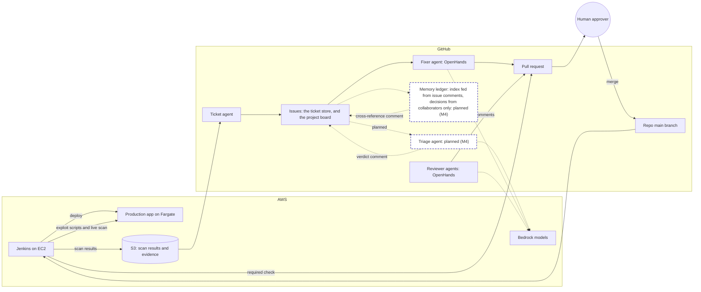
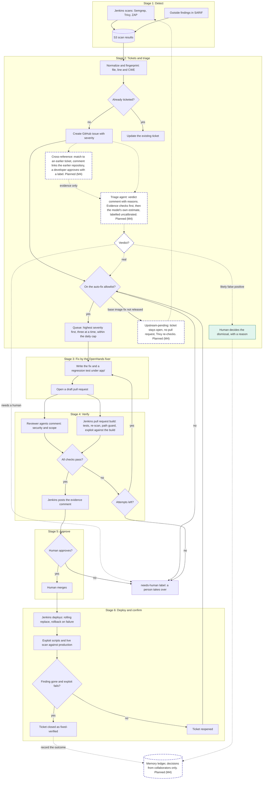
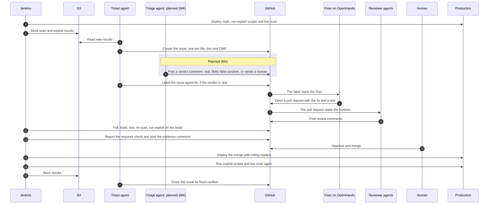
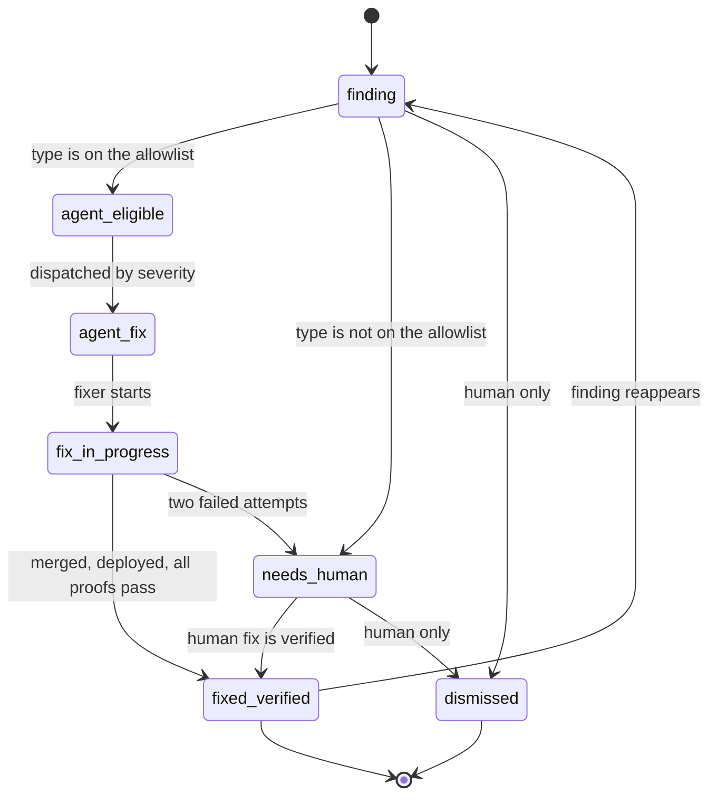
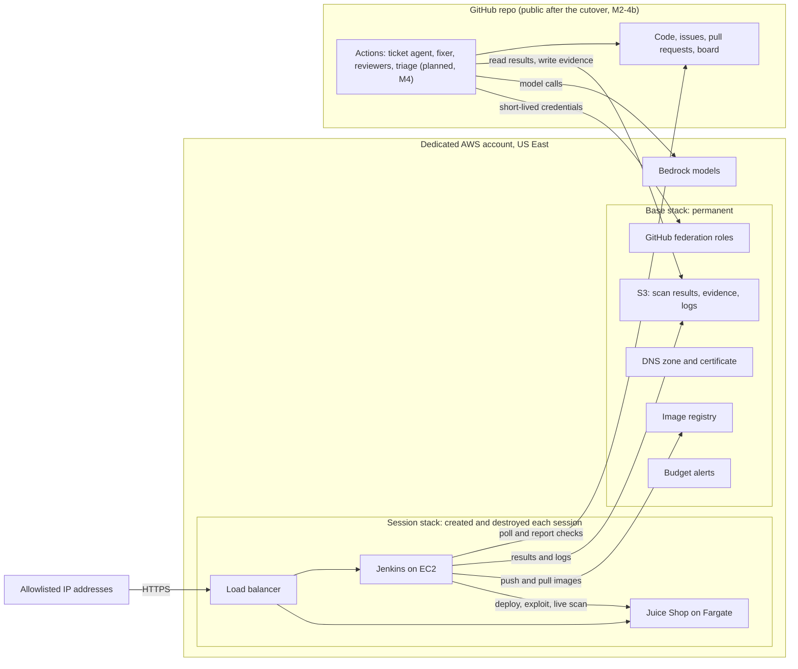

# Governed-Remediation: high-level design

| | |
|---|---|
| Version | 0.13 (draft for review) |
| Date | 2026-11-18 |
| Owner | Sandeep Kesarkar |
| Status | Design agreed in brainstorm. Nothing is built yet. The plan is in `docs/PLAN.md`. |

This document is the basis for later development. Each numbered design section is meant to become one or more specs (for example in SpecKit). Items marked **(assumption)** or **(unverified)** must be settled by the spikes in `docs/PLAN.md` before the specs that depend on them are written.

## 1. Purpose

AI models are starting to find software vulnerabilities much faster than teams can fix them. Governed-Remediation shows how an organization can automate the fixing side safely: findings become tickets, an AI coding agent (OpenHands) proposes fixes, other agents review them, a tool confirms each fix, a human approves, and a pipeline deploys. Every step is logged and cost-capped.

**The claim the demo must prove:** vulnerability fixing can be automated end to end, quickly, while a human stays in control of what ships.

**Who it is for:** prime contractors, companies and agencies that want to automate vulnerability management and save developer time.

**What it is:** a personal portfolio project. It is a demo. It is not past performance and must not be described as a client deployment.

## 2. Goals and non-goals

### Goals for v1

- Run the full loop on AWS against one deliberately vulnerable app.
- Accept findings from any source in SARIF format, not only the built-in scanners.
- Prove each fix three ways: the scanner no longer reports it, a new regression test passes, and a scripted attack that worked before now fails.
- Keep a human as the only one who can merge.
- Record an evidence bundle for every fix.
- Report four numbers: time from finding to deployed fix, fix success rate, model cost per fix, and human minutes per fix.

### Non-goals for v1

- No staging environment. There is one environment, called production.
- No automatic merge, ever, in v1.
- No automatic fixing of live-scan (DAST) findings. Those create tickets and verify fixes.
- No multi-repo operation. Section 14 shows how it would work, on paper only.
- No pausing of agents when the infrastructure is down (later phase).
- CloudBees CI is a later phase (section 15).

## 3. System overview

This section has five diagrams. The mermaid source of the two pictures is in `docs/images/src/`; `make diagrams` renders the SVGs from it. Dashed boxes and lines mark what is planned (M4) or from M3 and is not built. Task status is in `docs/PLAN.md`. The diagrams show the design, not the current build.

This section has five diagrams: the steps as a continuous loop, the local architecture in Docker, the components and how they connect, the end-to-end workflow with its decision points, and one fix followed step by step. Section 6 has the ticket states and section 12 has the AWS layout.

### The loop at a glance

The steps only. Nobody starts each step by hand: every step is started by the one before it, and the last step feeds the first, so the workflow keeps running for as long as a session is up.



What keeps each step running:

| Step | Started by | Runs on |
|---|---|---|
| Scan | Session start, every deploy, every pull request, or a new SARIF report in the inbox | Jenkins |
| Create and rank tickets | A schedule, every few minutes, reading new results from S3 | GitHub Actions |
| Triage (planned, M4) | A new ticket | GitHub Actions |
| Fix | The `agent-fix` label, applied by the dispatcher when a slot and budget are free | GitHub Actions |
| Review and verify | The pull request opening (reviewers) and Jenkins polling GitHub every minute (build) | GitHub Actions and Jenkins |
| Approve and merge | The human, prompted by a GitHub notification | GitHub |
| Deploy | The merge to `main`, picked up by Jenkins polling | Jenkins |
| Confirm | The deploy finishing | Jenkins |
| Close the ticket | The confirming results arriving in S3 | GitHub Actions |

The only step that waits for a person is the approval. The loop pauses in three cases: the daily cost cap is reached, the kill switch is on, or the session's infrastructure has been destroyed. Tickets and open pull requests stay in GitHub, so the loop picks up where it left off in the next session.

### Local architecture in Docker

The loop is built and proven on one Mac first, with everything in containers. AWS hosting comes after (section 12). This is the architecture for that local stage. Numbers in the drawing match the loop steps.



What runs where:

| Piece | Where | Purpose | From |
|---|---|---|---|
| Juice Shop: production | Container, port on `127.0.0.1` only | The running app that gets scanned, attacked and redeployed | M1 |
| Juice Shop: pull request build | Throwaway container | Lets the verify step test and attack a fix before the merge | M2 |
| Scanners | Containers | Semgrep, Trivy and ZAP, writing SARIF to the output folder | M1 |
| Exploit runner | Container | Runs the hand-written attack scripts | M1 |
| Test runner | Container | Runs the app tests and the new regression test | M2 |
| OpenHands fixer | Container with its own sandbox | The headless SDK. Sees only a throwaway copy of the repo, which keeps `codefixes` and the snippet comments. | M1 |
| Triage agent | Container with its own sandbox | Posts a verdict comment. Sees only a throwaway copy with the snippet comments stripped. | M4 (planned) |
| Jenkins | Container | Replaces the hand-run loop scripts for verify and deploy | M3 |
| OpenHands agent server | Container | Backend for the OpenHands desktop app | M3 |
| Loop commands | On the Mac | One command per loop step, started by hand in the first slice | M2 |
| OpenHands desktop app | On the Mac | A window for showing fixes and past runs. The agent's work stays in containers. | M3 |
| GitHub | Outside | Issues, pull requests, the `main` branch | M0 |
| Model | Outside | The Anthropic API first, Amazon Bedrock from M3 | M1 |

Local safety rules:

- Nothing from Juice Shop is installed on the Mac. It runs only in containers.
- Every published port is bound to `127.0.0.1`, so nothing else on the network can reach the vulnerable app.
- Every container, image, volume and network carries the label `project=governed-remediation`, and one command removes all of them.
- The fixer never uses the unsandboxed runtime. It gets the model key and, later, a narrow GitHub token. It gets no AWS credentials and no other folders from the Mac.

How the local stage differs from the AWS stage:

| Part | Local stage | AWS stage |
|---|---|---|
| Production | A container on the Mac, loopback only | Fargate behind an allowlisted load balancer |
| Pipeline | Loop scripts, then Jenkins in a container | Jenkins on EC2 |
| Fixer and reviewers | A local container, then GitHub Actions | GitHub Actions |
| Model access | Anthropic API key, then Bedrock | Bedrock with short-lived credentials |
| Results and evidence | A local output folder | S3 |
| Lifetime | Started and removed by hand | Created and destroyed per session |

### Components and connections

This is the target design, with production and Jenkins on AWS.



The loop in words:

1. Jenkins deploys `main` to production, then runs the exploit scripts and the live scan against it. Code and dependency scans run on every pull request and merge. Results go to S3.
2. The ticket agent turns new results into GitHub issues, removes duplicates (one ticket per file, line and CWE), sets severity, and decides which tickets are eligible for the fixer. *Planned (M4):* a triage agent then posts a verdict comment, and a memory ledger can link a new ticket to an earlier one.
3. The fixer agent, built on OpenHands, takes the highest-severity eligible tickets, three at a time, and opens one pull request per fix.
4. Two reviewer agents comment on the pull request. The fixer gets one revision round.
5. Jenkins builds the pull request, runs tests and re-scans. Its result is a required check.
6. The human reads one evidence comment, approves, and merges.
7. Jenkins deploys the merge. The exploit scripts and scans run again, and the ticket agent closes tickets whose findings are gone.

### End-to-end workflow

The six stages, with every decision point and every route to a human.



### One fix, step by step

Who does what, in order, for a single finding that the fixer handles successfully.



## 4. Components

| Component | Choice | Runs on |
|---|---|---|
| Target app | OWASP Juice Shop v20.0.0 (MIT), vendored under `app/` | Fargate |
| Code scan (SAST) | Semgrep Community Edition | Jenkins |
| Dependency and infrastructure scan | Trivy | Jenkins |
| Live scan (DAST) | OWASP ZAP | Jenkins, against production |
| Ticket agent | Python script plus one model call per ticket for the summary | GitHub Actions |
| Triage agent (planned, M4) | Design later. Works on a throwaway copy with the snippet comments stripped. | GitHub Actions |
| Fixer agent | OpenHands SDK, mid-tier Claude model on Bedrock | GitHub Actions |
| Reviewer agents | OpenHands PR review, OpenAI model on Bedrock | GitHub Actions |
| CI/CD | Jenkins LTS, configuration as code | EC2 |
| Infrastructure as code | AWS CDK in Python | Developer machine |
| Backlog view | GitHub Issues and a GitHub Projects board | GitHub |
| Evidence store | S3 | AWS |

## 5. Production environment

- **Shape:** one Juice Shop container as an ECS Fargate service behind an Application Load Balancer.
- **Access:** only a short allowlist of IP addresses can reach it. Juice Shop is deliberately vulnerable and must never be open to the internet.
- **Address:** HTTPS on a delegated subdomain of `<your-domain>`, for example `app.gr.<your-domain>` and `jenkins.gr.<your-domain>`. The subdomain gives an encrypted Jenkins login and an address that does not change between sessions.
- **Lifetime:** created at the start of a working session and destroyed at the end.
- **Deploys:** rolling replace with a health check. If the new version fails the check, the service rolls back to the previous image.
- **Data:** the app's database lives in the container and resets on every deploy. That is accepted.
- **Traceability:** each running version carries its image digest and commit. From production you can follow the chain to the pull request, the ticket, the approver and the evidence bundle.
- **Isolation:** the app's task role has no useful AWS permissions. A compromised app can reach nothing else.

## 6. Findings intake and tickets

### Intake

- Every source produces SARIF: Semgrep, Trivy, ZAP, and any outside report (including AI-generated ones) dropped into an inbox location.
- The ticket agent normalizes each result to one internal finding record.
- **Fingerprint** = file + line + CWE (decided 2026-11-18). One ticket per location and vulnerability class, so two rules on one line give one ticket. Rule IDs are listed in the ticket and are not part of the key. If the line moves, a whitespace-stripped hash of the flagged line finds the open ticket, and the line is updated. The hash is not used for secret findings. The same finding seen twice maps to the same ticket.

### Ticket lifecycle

| State (label) | Meaning | Who sets it |
|---|---|---|
| `finding` | New ticket, with severity and source labels | Ticket agent |
| `agent-eligible` | Finding type is on the auto-fix allowlist | Ticket agent |
| `agent-fix` | Dispatched to the fixer | Ticket agent (dispatcher) |
| `fix-in-progress` | Fixer is working or a pull request is open | Fixer |
| `needs-human` | Fixer failed twice, or the type is not on the allowlist | Fixer or ticket agent |
| `dismissed` | False positive or accepted risk, with a required reason | Human only |
| `fixed-verified` | Finding is gone after deploy and the exploit fails. Ticket closes. | Ticket agent |

A closed ticket reopens if a later scan shows the finding again.



### Rules

- **Auto-fix allowlist (initial):** injection flaws, hard-coded secrets, and dependency upgrades. Everything else goes to `needs-human`.
- **Order and concurrency:** highest severity first, at most three fixes in progress.
- **Budget:** the dispatcher stops handing out work when the daily spend cap is reached (section 10).
- **Dismissal:** only a human can dismiss a finding. An agent may recommend it in a comment.
- **Backlog view:** a GitHub Projects board with one column per state, plus the four demo metrics.

## 7. Agents

Each agent role has its own GitHub App with the minimum permissions.

| Agent | Reads | Writes | Cannot |
|---|---|---|---|
| Ticket agent | Scan results in S3, issues | Issues, labels, board | Touch code or pull requests |
| Fixer | Repo, the assigned issue | A branch and a draft pull request, changes under `app/` only | Approve, merge, or change files outside `app/` |
| Security reviewer | Pull request diff, the finding | Pull request comments | Push code, approve, merge |
| Scope reviewer | Pull request diff | Pull request comments | Push code, approve, merge |

### OpenHands

OpenHands (https://github.com/OpenHands/openhands) is the open-source AI coding agent that does the vulnerability fixing in this design. It also powers the two reviewers.

| Use | OpenHands piece | Status |
|---|---|---|
| Fixing a finding and opening the pull request | The OpenHands Software Agent SDK, run from a GitHub Actions workflow we write | Mechanism to confirm in a spike |
| Reviewing the pull request | The OpenHands PR review action (`OpenHands/extensions/plugins/pr-review`) with our own review prompts | Exists. Model choice to confirm in a spike. |
| Reference material | The OpenHands vulnerability-remediation plugin and Vulnerability Fixer example app | To study, not to deploy as-is |

- **Why OpenHands:** the core is MIT licensed, it runs headless in a pipeline, and it reaches Bedrock models through AWS credentials, so model traffic stays in our AWS account.
- **Why our own workflow around it:** we need control over the prompt, the Bedrock role, the per-run cost cap, the two-attempt limit and the branch rules. A ready-made fixer would hide those.
- **What OpenHands does not decide:** which tickets it gets, whether a fix is accepted, and whether anything merges or deploys. The dispatcher, Jenkins and the human decide those.
- **Version:** pin a specific OpenHands release and upgrade on purpose.
- **First runs:** the first spikes and the local thin slice use the headless SDK with an Anthropic API key. Bedrock replaces the key in milestone M3.
- **Desktop app:** OpenHands also has a desktop app, Agent Canvas, which is in early preview. We use it only as a window for the demo, to show the agent's fixes and its past runs. It always points at a Docker backend limited to the project folder, never at its default mode, where the agent runs directly on the machine. It is off the critical path: if it misbehaves, the demo loses a scene and nothing else. Whether it can show runs started by the headless pipeline is a spike.

### Fixer

- Built on OpenHands (see above).
- Triggered by the `agent-fix` label.
- Makes the smallest change that closes the finding.
- **Must add a regression test** for every code fix. The test fails on the old code and passes on the new code.
- **One pull request per code finding.** Dependency upgrades are grouped into one pull request.
- **Two attempts.** After the second failure it labels the ticket `needs-human` and explains what it tried.
- May respond to reviewer comments once. After that the pull request goes to the human as it stands.
- Opens pull requests with its GitHub App token. Pull requests opened with GitHub's default workflow token do not trigger other workflows, so the reviewers would never run.

### Reviewers

- **Security reviewer:** a different model family from the fixer. Asks whether the fix really closes the hole and whether it opens a new one.
- **Scope reviewer:** asks whether the change is minimal, whether tests were weakened or removed, and whether new dependencies appeared.
- Both only comment. Their verdicts are summarized in the evidence comment.

### Models

- Fixer: a mid-tier Claude model on Bedrock to start. Measure the success rate and move up a tier only if it fails too often.
- Reviewers: an OpenAI model on Bedrock. **(unverified)** The frontier OpenAI models on Bedrock use the Responses API only. Whether the OpenHands reviewer can use that path is a spike. Fallbacks: an OpenAI open-weight model on Bedrock, or a different Claude tier.
- Agents get short-lived AWS credentials through GitHub's identity federation (OIDC). The role allows model invocation only.

## 8. Pipeline (Jenkins)

- **Setup:** configuration as code. A fresh Jenkins comes up fully configured each session. Build logs are archived to S3, and Jenkins keeps no history between sessions.
- **Access:** behind the same IP allowlist as the app, over HTTPS.
- **Pull request discovery:** Jenkins polls GitHub about once a minute. No inbound webhook.
- **Builds:** in Docker containers on the Jenkins instance.

### Pull request pipeline

1. Build the app image.
2. Run a subset of the app's tests plus the new regression test.
3. Run Semgrep and Trivy.
4. Run the path guard: fail if an agent-authored pull request touches anything outside `app/`.
5. Start the built image in a throwaway container on Jenkins and run the exploit script for the targeted finding against it. The attack must fail. This shows the human an exploit result before the merge. Production is checked again after the deploy.
6. Report one required status check and post the evidence comment on the pull request.

**Gate rule:** Juice Shop has hundreds of intentional findings, so "zero findings" is not usable. The check fails if the targeted finding is still present, or if the change introduces any new high or critical finding.

### Main pipeline (after a human merges)

1. Build and push the image.
2. Deploy with rolling replace, health check and rollback.
3. Run the exploit scripts against production.
4. Run a quick ZAP scan plus a targeted scan of the curated endpoints.
5. Write all results to S3. The ticket agent then closes or reopens tickets.

## 9. Proving a fix

A fix counts as verified only when all of these hold:

| Proof | Before the fix | After the fix |
|---|---|---|
| Scanner | Reports the finding | Does not report it |
| Regression test | Fails | Passes |
| Exploit script | Attack succeeds against production | Attack fails against production |

- Exploit scripts are written by hand during development, one per curated finding (3 to 5 to start). Agents do not write exploits.
- A manifest maps each exploit script to the finding it proves.
- The same exploit suite runs after every deploy, so the "before" result comes from the deploy that preceded the fix.
- Candidate curated findings **(assumption, confirm from the first scans):** a SQL injection in login, a hard-coded secret, a vulnerable npm dependency, and a reflected cross-site scripting flaw.

## 10. Governance controls

| Control | How it is enforced | What it shows |
|---|---|---|
| Human is the only merger | Branch protection: one human approval and all required checks. Agent apps cannot approve or merge. | Human in the loop |
| Agents change app code only | Path guard check, and CODEOWNERS on pipeline, infrastructure and agent files | Limited scope |
| A tool confirms every fix | Jenkins re-scan and tests are required checks | The agent's word is not enough |
| Independent review | Fixer and security reviewer use different model families | Separation of duties between models |
| Cost caps | Per-run cap in the fixer, daily cap in the dispatcher, AWS budget alerts as a backstop | Cost control |
| Kill switch | One repository setting that every agent workflow checks before it starts. Disabling the GitHub Apps is the hard stop. | Operational control |
| Full audit trail | Evidence bundle per fix, Bedrock invocation logging, GitHub and Jenkins logs | Auditability |
| Least privilege | One GitHub App per role, short-lived AWS credentials, no deploy rights for agents | Small blast radius |
| Pinned supply chain | Third-party actions pinned by commit, images pinned by digest | Pipeline integrity |
| Separate approver (off in v1) | A setting that, when on, requires the approver to differ from the person who triggered the fix | Separation of duties between people |

In v1 one person (the owner) triggers and approves. The separate-approver setting exists in the design and is switched off.

### Evidence bundle

One folder per fix in S3, linked from the pull request. It holds the finding, the agent's full transcript, the diff, scanner and exploit results before and after, reviewer verdicts, the approver, the deploy record and the model cost.

### Evidence comment

A single comment on the pull request that lets the human decide in about two minutes: the finding, what changed, re-scan result, test result, exploit result against the pull request build, reviewer verdicts and cost. Jenkins posts it when the pull request pipeline finishes.

### Framework mapping

A one-page table will map these controls to NIST's Secure Software Development Framework and OWASP's guidance on agent security. It will be written in milestone M6 and checked against the published texts, not from memory.

## 11. Threat model (one page)

A full MAESTRO threat model follows once the fixer works.

| Threat | Main defenses |
|---|---|
| Prompt injection through code comments, issue text or scan output | All of it is treated as untrusted. Path guard, minimal permissions, no secrets in the fixer's reach, human merge. |
| Agent weakens tests, adds a dependency, or edits the pipeline | Scope reviewer, path guard, CODEOWNERS, gate rule |
| Stolen or over-scoped agent credentials | One app per role, short-lived credentials, model-invoke-only AWS role |
| The vulnerable app is attacked | IP allowlist, no useful task role, destroyed after each session |
| Runaway cost or agent loops | Per-run and daily caps, two-attempt limit, budget alerts, kill switch |
| A "fix" that only hides the finding from the scanner | Regression test and exploit script must also pass |

## 12. AWS design

- **Account:** a new AWS account used only for this demo, with budget alerts.
- **Region:** US East (N. Virginia).
- **Infrastructure as code:** AWS CDK in Python, in two stacks.

| Stack | Lifetime | Contents |
|---|---|---|
| Base | Permanent, very low cost | Image registry, S3 buckets (scan results, evidence, logs), DNS zone for the subdomain, certificate, GitHub identity federation and roles, budget alerts |
| Session | Created and destroyed each working session | Network, load balancer, Fargate service, Jenkins instance |



- **Network:** public subnets with tight security groups and no NAT gateway, to keep cost down. Only the load balancer accepts traffic, and only from the allowlist. Jenkins must also be allowed to reach the app for the live scan and exploit scripts.
- **Jenkins image:** prebuilt and stored in the registry so a session starts quickly. Target: ready in about 10 minutes.
- **Infrastructure scanning:** Trivy scans the CloudFormation templates that CDK generates.

## 13. Cost estimate

These are planning figures. Token counts per fix are assumptions and must be measured in the spikes. Prices were checked on 2026-11-11 except where marked.

### Infrastructure, per session hour

| Item | Rate | Per hour |
|---|---|---|
| Fargate task, 1 vCPU and 2 GB | $0.04048 per vCPU-hour, $0.004445 per GB-hour | $0.049 |
| Load balancer | $0.0225 per hour plus about one capacity unit at $0.008 | $0.031 |
| Public IPv4 addresses, four | $0.005 per address-hour | $0.020 |
| Jenkins instance, t3.large | about $0.083 per hour (from memory, unverified) | $0.083 |
| **Total** | | **about $0.18** |

At about 100 session hours a month, that is roughly **$18**. Permanent items (DNS zone, image storage, S3, logs) add a few dollars. Plan on **$20 to $25 a month** for infrastructure.

### Models, per fix

| Step | Assumed tokens | Price per million (input / output) | Cost |
|---|---|---|---|
| Fixer run, light | 300K in, 10K out | $3 / $15 (mid-tier Claude, conservative) | about $1.05 |
| Fixer run, heavy | 1.5M in, 30K out | $3 / $15 | about $4.95 |
| Two reviews | 100K in, 5K out each | $2.75 / $16.50 (GPT-5.4 on Bedrock, US) | about $0.72 |
| Ticket summary | small | | cents |

Planning figure: **about $3.70 per fix** (a $3 fixer run plus reviews). Prompt caching should lower it.

### Monthly total

| Month type | Fix runs | Models | With infrastructure |
|---|---|---|---|
| Light development | 15 | about $56 | about $80 |
| Heavy development | 40 | about $149 | about $170 |

**Agreed starting caps:** $5 per fixer run, $10 per day, and an AWS budget of $150 a month with alerts at 50, 80 and 100 percent. Revisit after the spike measurements.

The local stage costs only model usage, since nothing runs on AWS until milestone M5.

GitHub Actions minutes are free for public repositories. Private repositories have a monthly free allowance **(unverified amount)**.

## 14. Multi-repo design (on paper)

- The agent workflows are written as reusable workflows from the start.
- A second application repo would add a thin caller workflow and one config file (allowlist, caps, scan settings).
- The three GitHub Apps would be installed across the organization.
- Each repo keeps its own tickets, board and evidence prefix. A central view would aggregate the metrics.

v1 keeps everything in one repo and does not build this.

## 15. Future phase: CloudBees CI

- **Why:** a vendor has an upcoming project on CloudBees and wants to see this capability there.
- **Expected change:** CloudBees CI is built on Jenkins, so the same pipeline definition should run with little change. Builds would move to Kubernetes agents, which means an EKS cluster and higher cost.
- **What the comparison should show:** role-based access, audit, and central management, not different pipeline syntax.
- **Access:** not yet obtained. The CloudBees CI trial lasts 7 days and credentials come by email from a CloudBees representative, so request it only when milestone M7 is ready to start.

## 16. Repo layout

The repo is private and lives in the owner's personal GitHub account. Branch protection on a private repo needs a paid GitHub plan (GitHub Pro for a personal account). The human-only merge control depends on it, so that plan, or a public repo, must be in place before milestone M6.

```
governed-remediation/
  app/                  Juice Shop source (the only place agents may change)
  infra/                CDK app in Python (base and session stacks)
  jenkins/              Jenkinsfile, configuration as code, image build
  .github/workflows/    ticket agent, fixer, reviewers (reusable workflows)
  agents/               prompts, ticket-agent code, review skills, allowlist
  exploits/             hand-written exploit scripts and manifest
  scripts/              loop step scripts (up, scan), session up and down, demo reset
  scan/                 scanner settings (pinned image, rule sets, exclusions)
  tests/                tests for our own code (Python in tests/, shell step tests)
  docs/                 this HLD, the plan, spike notes, threat model, demo script
  spikes/               throwaway spike code
  specs/                specs, from the thin slice onward
  CODEOWNERS
  CLAUDE.md             working rules for Claude Code
  README.md
```

## 17. Demo plan

Delivered live and as a recording. About 10 minutes.

1. Show production and run an exploit: the attack works.
2. Show the findings and the ticket board.
3. A ticket is dispatched. The fixer opens a pull request.
4. Show the reviewer comments, the Jenkins check and the evidence comment.
5. Approve and merge as the human.
6. Jenkins deploys. Run the exploit again: the attack fails. The ticket closes.
7. Show a failure: a ticket that ends in `needs-human` with the agent's explanation.
8. Show a prompt injection attempt planted in a code comment, and the controls that stop it.
9. Show the kill switch and the cost cap stopping the queue.
10. Close on the four metrics and one evidence bundle.

## 18. Build order and milestones

The loop is built and proven locally in Docker first, then moved to AWS. The first working version is a thin slice: one finding through the whole loop, with each step started by hand. Short experiments called spikes remove the unknowns before each stage.

The full plan, with tasks, the spike register and status, is in `docs/PLAN.md`. The milestones:

| ID | Milestone | Done when |
|---|---|---|
| M0 | Setup | Repo exists, rules and plan are committed, the clean-up command works |
| M1 | Local spikes | Juice Shop, the scanners, an exploit and the OpenHands fixer are each proven in containers |
| M2 | Local thin slice | One finding goes through the whole loop on the Mac with a real pull request |
| M3 | Real parts in the loop | Jenkins in Docker replaces the scripts, the fixer and reviewers run in GitHub Actions on Bedrock |
| M4 | Strengthen | Full ticket handling, dispatcher, 3 to 5 findings, failure path, evidence |
| M5 | AWS hosting | The loop runs against production on AWS, created and destroyed per session |
| M6 | Governance and demo | Caps, kill switch, metrics, control mapping, recorded demo |
| M7 | CloudBees CI | The same pipeline runs on CloudBees CI |

Working time is about three hours a day, built by the owner with AI coding assistance.

## 19. Open items

| Item | Needed by |
|---|---|
| Results of the spikes in `docs/PLAN.md`: the OpenHands mechanism, token cost per fix, an OpenAI reviewer on Bedrock | M1 and M3 |
| License for our own code. Juice Shop's MIT license and notice stay under `app/`. | Decided: MIT, `LICENSE` added (M2-4b-prep) |
| Semgrep rule license terms for this use | M4 |
| Which IP addresses go on the allowlist | M5 |
| Processor type for Fargate, since images are built on Apple silicon | M5 |
| GitHub Pro or a public repo, for branch protection | M6 |
| **Pre-publication checklist.** The tree is copied into a fresh public repo as one clean commit (task M2-4b). Status as of 2026-11-18: | |
| LICENSE file at the repo root (MIT, own code). `app/LICENSE` is untouched. | Done (M2-4b-prep) |
| Secrets scan: `make scan-secrets` (gitleaks, pinned, MIT licence, in a labelled container). Allowlist by exact path, scoped to the rule IDs that fired: the five fake-key files and 20 files of upstream tests, sample data and source, all listed in `app/PROVENANCE.md`. Clean. A planted fake secret outside `app/` still fails the scan, and so does a different rule inside an allowlisted file. | Done (M2-4b-prep, owner decision 2026-11-18) |
| No Semgrep rule text and no SARIF files are tracked (checked: no `.sarif` file, no scan output, no rule message text; the reader never keeps it) | Done (M2-4b-prep) |
| Banned-terms search on tracked files, with `app/` excluded, is empty | Done (M2-4b-prep) |
| Personal-detail sweep of tracked files outside `app/` (home paths, addresses, hostnames, serial numbers) | Done (M2-4b-prep) |
| `.env` is not tracked, and `.env.example` has names only | Done (M2-4b-prep) |
| Every README link resolves | Done (M2-4b-prep) |
| The nine bundled JS files under `app/frontend/src/assets/private/` that name authors but state no licence: keep exactly as upstream ships them (owner decision, 2026-11-18) | Done (decided) |
| CloudBees CI trial access | M7 |

## 20. Price sources

- AWS Fargate pricing: https://aws.amazon.com/fargate/pricing/
- Elastic Load Balancing pricing: https://aws.amazon.com/elasticloadbalancing/pricing/
- Amazon Bedrock pricing: https://aws.amazon.com/bedrock/pricing/
- GPT-5.4 on Amazon Bedrock model card: https://docs.aws.eu/bedrock/latest/userguide/model-card-openai-gpt-54.html
- CloudBees CI trial guide: https://docs.cloudbees.com/docs/cloudbees-ci-migration/latest/trial-guide/
